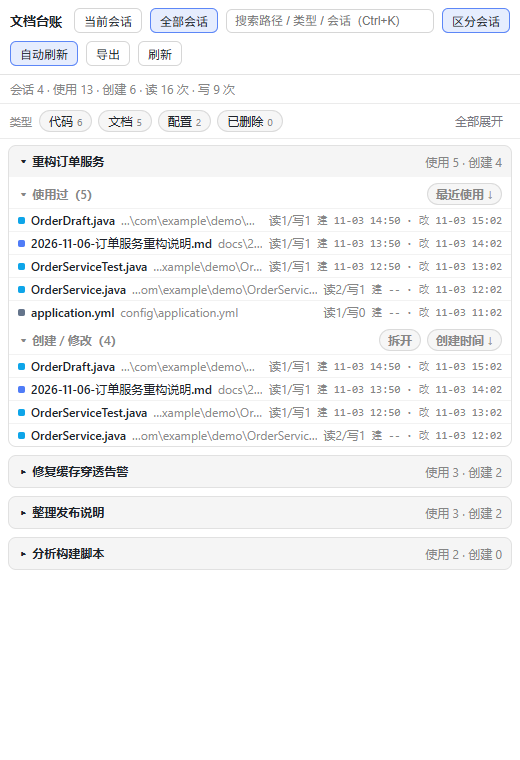

# dsh-doc-ledger

[](https://github.com/LuoShanHui/dsh-doc-ledger/actions/workflows/ci.yml)
[](https://www.npmjs.com/package/dsh-doc-ledger)
[](LICENSE)

[English](README.md) · **中文**

**每个会话一份文档台账**：这个会话用过哪些文档、创建 / 修改了哪些，带时间排序、类型分组、搜索、跨会话汇总，以及两种预览入口。



<details>
<summary><b>目录</b></summary>

- [30 秒上手](#30-秒上手)
- [它做什么](#它做什么)
- [截图](#截图)
- [安装（插件形态）](#安装插件形态)
- [安全模型](#安全模型)
- [已知限制](#已知限制)
- [参考](#参考)
  - [数据模型](#数据模型)
  - [界面](#界面)
  - [预览：默认交给 DSH 自己的文档预览](#预览默认交给-dsh-自己的文档预览)
  - [预览的编码处理](#预览的编码处理只作用于快速查看弹窗)
  - [打开文件的实现](#打开文件的实现)
  - [打开方式：列出所有关联程序](#打开方式列出所有关联程序)
  - [真实程序图标](#真实程序图标)
  - [排序菜单](#排序菜单)
  - [刷新不打断阅读](#刷新不打断阅读)
  - [路由](#路由)
  - [请求与缓存](#请求与缓存性能)
- [踩过的坑](#踩过的坑)
- [已验证 / 未验证](#已验证--未验证)
- [PTC 预设会话怎么记](#ptc-预设会话怎么记)
- [当前会话怎么定位](#当前会话怎么定位)
- [文件](#文件)

</details>

## 30 秒上手

```jsonc
// ~/.dsh/profiles/<profile>/package.json
"dependencies": {
  "dsh-doc-ledger": "github:LuoShanHui/dsh-doc-ledger#v0.4.0"
}
```

1. 加上面这行依赖（`#v0.4.0` 固定版本；想跟最新开发版就写 `github:LuoShanHui/dsh-doc-ledger`）。
   也发布了 npm 包，可以换成 `"dsh-doc-ledger": "0.4.0"`；
2. 用运行时自带的 pnpm 安装，复用已有 store（完整命令见下文「安装（插件形态）」）；
3. 在 `cordis.patch.yml` 末尾 insert 一行 `doc-ledger`（同样在那一节），刷新页面 → 右侧栏出现「文档台账」。

要求：DSH `>=0.2.0-rc.1 <0.3.0-0`、Windows。装不上或想改代码时看「安装（插件形态）」里的本地目录方式，行为边界看「已知限制」。

> 实验性：依赖宿主内部 API（`sessionQuery`、`webServer` 前缀路由、bundle patch 注入），
> 只在 DSH `>=0.2.0-rc.1 <0.3.0-0` 上验证过；宿主改接口时这个插件需要跟着改。

## 它做什么

| 形态 | 入口 | 说明 |
|---|---|---|
| 插件（会话内 tab） | 右侧 Sidebar 新增「文档台账」tab | 由 host 半侧提供页面路由，客户端半侧只负责挂载 tab；当前会话每 8 秒**静默**刷新一次（不显示加载态、不重建列表），快速查看打开时暂停 |
| 静态报告 | `node tools/report.mjs --limit 40` | 生成 `report.html`，双击即可看，不需要安装插件（生成物含真实路径，已 gitignore） |

一句话：打开这个 tab，就能看到本会话摸过的全部文档，分成**使用过**与**创建 / 修改**，可按类型筛选、多词 AND 搜索、每个分区独立排序，预览默认交给宿主的文档预览，也可以用自带的快速查看弹窗。

## 截图

| 文件 | 内容 |
|---|---|
| `docs/zh-overview.png` | 全部会话：摘要行、类型 chip、展开后的「使用过 / 创建 / 修改」 |
| `docs/zh-current.png` | 当前会话视图（只折叠当前会话，打开面板不用等全量重放） |
| `docs/zh-preview.png` | 快速查看弹窗：文件信息行、截断/解码提示、正文、完整路径、Esc 关闭 |
| `docs/zh-menu.png` | 右键菜单：「在侧边栏预览」/「快速查看」在前，「打开方式」列出为扩展名注册的程序（带真实图标） |
| `docs/zh-filter.png` | 类型筛选生效：选中的 chip 变蓝，右侧出现 `✕ 清除筛选` 与「全部展开」 |
| `docs/zh-session.png` | 会话卡片右键菜单：复制会话名称 / 会话 ID、跳转到这个会话 |
| `docs/zh-sort.png` | 分区排序菜单：每个分区独立排序、再点一次切方向 |
| `docs/en-overview.png` | **英文界面**（`?locale=en`）：同一份代码、同一份数据，只换语言 |

截图里的工作区（`C:\work\demo-workspace`）、文档名和程序列表都是示例数据，
不是任何人的真实项目。

## 安装（插件形态）

**profile 是一个 pnpm 工程**（`~/.dsh/profiles/<profile>` 下有 `package.json` / `pnpm-lock.yaml` /
`pnpm-workspace.yaml`），DeepSeek Harness 启动时会跑 install，**把没写进 `package.json` 依赖的目录直接清掉**。
所以不要把包直接 `cp` 进 `node_modules/`：下次启动它会消失。

1. 在 `~/.dsh/profiles/<profile>/package.json` 的 `dependencies` 里加一行 GitHub 托管依赖
   （pnpm 会直接拉仓库，**不需要先 clone**；`#v0.4.0` 固定版本，省掉 tag 就跟开发版）：

   ```json
   "dsh-doc-ledger": "github:LuoShanHui/dsh-doc-ledger#v0.4.0"
   ```

   想改代码或内网环境，就改成指向本地目录：

   ```json
   "dsh-doc-ledger": "file:<path>/dsh-doc-ledger"
   ```

   也可以走 npm（`https://www.npmjs.com/package/dsh-doc-ledger`，与 GitHub tag 同一份代码，
   少了 clone 仓库这一步；内网或镜像源上可能还没同步）：

   ```json
   "dsh-doc-ledger": "0.4.0"
   ```

2. 用运行时自带的 pnpm 安装（`<runtime>` 换成你的运行时目录；**复用已有的 store**，
   否则 pnpm 会提示要清空整个 `node_modules`）：

   ```powershell
   node <runtime>/dependencies/pnpm/bin/pnpm.mjs install `
     --config.store-dir=<pnpm-store> `
     --config.confirmModulesPurge=false
   ```

3. 在 `~/.dsh/profiles/<profile>/cordis.patch.yml` 末尾加：

   ```yaml
   # dsh-doc-ledger: per-session document ledger sidebar tab
   - insert:
       - id: doc-ledger
         name: dsh-doc-ledger
         config:
           maxSessions: 40
           debug: false
   ```

4. 刷新页面（客户端 bundle 需要重新注入），右侧 Sidebar 出现「文档台账」。

验证：

- `GET /doc-ledger/api/all?scope=all` 返回 200 且有 `sessions[]`；
- `GET /doc-ledger/api/all?scope=current&session=<id>&timing=1` 返回 200，`data.timings.total` 通常在 20 ms 内；
- 右侧 Sidebar 出现「文档台账」tab，能看到当前会话的清单。

卸载：从 `package.json` 删掉那条依赖 → `pnpm install`（同样的参数）→ 删掉 `cordis.patch.yml` 里的 insert 行。

**换到别的 profile**：同样的三步，把 `desktop` 换成目标 profile 名即可。

## 安全模型

插件挂在宿主提供的回环端口上（`127.0.0.1`），但回环不等于安全：用户浏览的任何网页都能向
`http://127.0.0.1:<port>/doc-ledger/api/...` 发请求。所以宿主侧只认下面三条：

1. **同源校验**：`Sec-Fetch-Site` 是 `cross-site`/`same-site`、`Origin`/`Referer` 指向别的站点、
   或 `Origin: null` 的请求一律 403。
2. **只认台账里的路径**：`/api/file`、`/api/open`、`/api/openwith` 只接受当前缓存台账中出现过的文件，
   `C:\Windows\win.ini` 这类路径返回 403；`/icon` 只接受已存在的 `.exe/.ico/.lnk`。
3. **启动程序必须是 POST**：`/api/open` 拒绝 GET，``、链接、预取都不能把程序拉起来。

插件路由**不经过** GUI 的登录态（宿主只保护 `/`），上面三条就是它自己的全部防线。

## 已知限制

- **会话目录布局是隐式契约**：指纹来自 `~/.dsh/sessions/<项目>/<会话 id>/session.v4.jsonl.zstd`。
  找不到这个结构（换 `DSH_HOME`、运行时改布局）就自动退回到原来的 TTL 失效，功能不受影响，只是慢一点。
- **卡片懒挂载**：离视口很远的卡片只有标题，行要等滚动/聚焦上来才构建。
  拖滚动条瞬移时，会先看到几帧标题、随后补齐；这是用「按需构建」换 43 张卡全展开的首帧。
- **`exists` 有 20 秒缓存**：刚在磁盘上删掉的文件，最多 20 秒后才会显示成「已删除」。
- **界面双语（zh / en）**：`locale` 字典覆盖面板全部文案（159 个 key），跟随宿主的界面语言；数据本身
  （会话标题、文件名、路径、程序名）按原样显示、不翻译。实现与校验见 [`docs/i18n.md`](docs/i18n.md)。
- **shell 产生的文件不算创建**：PTC 程序里用 `git diff > x.diff`、PowerShell 重定向、解压等命令写出的文件，
  没有路径参数可抓，只会因为后续被读而出现在「使用过」。要覆盖得让运行时把 Shell 的文件写入也报上来。
- **整文件写入即视为创建**：如果某个程序不读就直接覆盖一个已存在的文件（PTC 的 `fs.writeFileSync` 允许），
  这个文件会被记成该会话「创建」。本机用「文件出生时间早于会话开始」反查过全部 43 个会话，
  0 例误报（能被 `stat` 到的文件都对得上）。
- **混编文件按行猜编码**：GB18030 与 UTF-8 在字节层面并不总是能区分，逐行取「替换字符更少」的那种是启发式——
  一个 UTF-8 文件里若恰好有一行只剩单个坏字节，那一行可能被读成看起来正常、实际不对的汉字；
  真正解不出的字节会如实标在提示行里，需要绝对准确时用「打开」交给编辑器。
- **「快速查看」弹窗只给前 200 KB**：再大也只读这么多（避免把几百兆的文件读进内存），完整内容靠「侧边栏」或「打开」。
- **宿主文档预览依赖 `openResource`**：没有这个方法的 DSH 版本会自动退回弹窗；宿主预览自己的解码策略没有在本仓库里验证，
  所以 GB18030 之类的文件想读准原文时仍建议用「快速查看」。

## 参考

下面都是实现细节：数据怎么算出来、界面每一块怎么行为、以及一些有意思的取舍。改代码时读它，装插件时不用。

### 数据模型

从会话日志折叠出每个文件的记录：

```
{ path, rel, name, ext, category,
  reads, writes, presented,
  firstUsedAt, lastUsedAt,      // 使用时间历史
  createdAt, updatedAt,          // 创建 / 更新时间
  created: "confirmed" | "inferred" | null,
  uses: [{ kind, op, time, seq, turn }] }
```

- **使用过**：`read` 类工具调用（含 `mcp__*__read_file`），每次调用都留时间戳，所以能给出「首次 / 最近 / 次数」和逐次时间轴。
- **创建 / 修改**：`write`、`edit` 调用。`created` 是三态：
  - `confirmed` — 走了 `present` 工具显式交付（事件 `deliverables/presented` 带路径）；
  - `inferred` — 首次写入前没有任何读取。默认观察策略要求覆盖前先读，所以「未读先写」在实践中约等于新建；
  - `null` — 只修改，不算创建。
- **失败调用**回滚：`tool/result` 带 `isError` 的调用会从台账里剔除，不会把报错算成「使用过」。
- **工作目录**：初始取会话 header 的 `cwd`，随成功的 `working_directory` 调用切换，相对路径按当时的 cwd 归一化。

插件形态的 React 面板是**唯一在维护的 UI**；静态报告只在导出时用 `lib/ui.js` 拼一份自包含 HTML。
旧的 `/doc-ledger/ui` 页面已下线（第二套 UI 没有打开方式、图标和拆分视图，重复维护没有收益）。

`uses[]`、`ext`、`birthtime`、`mtime`、`exists`、`presented` 只留在宿主内存里：HTTP 响应会按
`slimFile()` 瘦身，因为 `uses` 一项就占原响应的 30%，而客户端从不渲染它。

### 界面

- **当前会话**：创建/修改 + 使用过两个清单。
- **全部会话**：默认开启「区分会话」（每个会话一张卡片，卡片内再分创建/使用）；关掉则合并成两个跨会话清单，每行带会话标签。
- **视觉主题**：工具栏的「主题」按钮循环切换四套外观——**紧凑**（原版）/ **留白**（用留白和字重替代分隔线）/
  **表格**（网格行 + 等宽数字）/ **卡片**（浮起卡片 + 柔和阴影）。选择跨刷新记住，每套都读宿主的颜色 token，
  深浅色自动跟随。
- **类型过滤**：摘要行下方的类型 chip（文档 / 表格 / 演示 / 图片 / 代码 / 网页 / 配置 / 数据 / 压缩包 / 其他），
  按当前数据的实际分布显示数量，点一下只看该类型，再点取消；计数为 0 的类型不出现，选择会记住。
  chip 用「文字 + 小号计数」两级排版（计数 `tabular-nums`，选中时跟着变蓝），有底色和 120 ms 过渡，
  和分区标题右侧的排序 pill 是同一套形状语言。
- **只看已删除**：同一行的「已删除 N」chip 只留磁盘上已经不存在的文件（本机实测 123 行 / 23 个会话），
  和类型、搜索可以叠加。这个开关是临时的，不写进偏好。
- **清除筛选**：只要类型 / 已删除任一条件生效，chip 右边出现一条细分隔线 + `✕ 清除筛选`。
  它是**文字动作**而不是胶囊按钮——一眼能和「筛选 chip」区分开，颜色是中性灰（悬停才浮出一层浅底），
  鼠标和键盘都有反馈；点一下复位类型和「已删除」，搜索框里的词保留（标题里写明了这点）。
  右侧的「▾ 全部展开 / ▴ 全部折叠」用同一套动作样式，靠右对齐。
- **筛选反馈**：一旦有搜索 / 类型 / 已删除任一条件，摘要行后面追加「筛选后 X 个文件 / Y 个会话」，
  不再出现「筛出 25 行、摘要还写着 43 个会话」的割裂。
- **点击行**：默认交给 DSH 自己的「文档预览」在右侧栏打开（Markdown 渲染、图片、PDF、Office、表格、语法高亮都由宿主负责，
  见下一节）；`Shift+回车` 或菜单里的「快速查看」则是本篇自己的弹窗。

- **会话卡片**：点标题折叠或展开整张卡；「全部会话」默认全部收起，「当前会话」默认展开。
  卡片底部右侧「全部展开 / 全部折叠」一键处理所有卡片（43 张卡从 43 次点击变成 1 次）。
- **会话卡片右键菜单**：在「全部会话」里分不清两张卡时，右键卡片标题（不是行）就能
  「复制会话名称」/「复制会话 ID」，分隔线下面是「跳转到这个会话」。
  分隔线下面还有**子代理血缘**：payload 带 `parentSessionId`，子会话卡片多一项「跳到父会话：<标题>」，
  父会话卡片则列出已加载的子会话「跳到子会话：<标题>」（最多 5 个）。
  跳转调的是宿主自己的 `uiWorkspace.openSession(sessionId)`（语义就是「选中该会话并把对话显示出来」），
  所以点完左侧对话区直接切过去、右边栏保持不动；这个服务是**可选注入**（`ctx.inject(["uiWorkspace"], …)`），
  老版本 DSH 没有它时菜单里只有两条复制项，不会报错。
- **懒挂载**：只有滚动到附近（或获得焦点、被点开）的卡片才真的构建行节点，其余卡片只渲染标题；
  「全部折叠」时会把已挂载集合清空——折叠态本来就不建行，清空零成本，下次展开只挂视口附近那几张；
  43 张卡全展开时首帧从 204 ms / 8356 个节点降到 79 ms / 4172 个，随着滚动补齐，滚回去不会塌陷。
- **两个分区**：「使用过」和「创建 / 修改」各自可折叠，标题前的 ▾ 或 ▸ 就是状态。
- **每行时间**：`建 11-03 14:20 · 改 11-04 09:12`，创建时间与修改时间同时显示，不再靠排序猜；
  不是今年的时间会带上年份（`2025-11-04 10:33`）。
- **已删除标记**：磁盘上已经不在的文件那行会变暗、行首标「已删除」，悬停提示「文件已不存在」，
  预览仍可读到历史内容（读不到就提示原因）。`rev` 指纹里带了「已删除数量」和标题，
  所以文件在磁盘上消失后，**静默轮询也会把标记刷出来**（旧版 rev 只看事件计数，删了文件也不刷新）。
- **排序**：每个分区标题右侧有自己的排序按钮，点开是菜单；**再点一次同一个按钮就收起**，
  点菜单里当前项则切换升/降序（↑/↓）。
  - 使用过：最近使用 / 首次使用 / 读取次数 / 存在状态 / 类型 / 路径
  - 创建：创建时间 / 更新时间 / 写入次数 / 存在状态 / 类型 / 路径
  - 修改：更新时间 / 创建时间 / 写入次数 / 存在状态 / 类型 / 路径
  - 「存在状态 ↑」= 还在的文件在前，「↓」= 已删除的在前
- **拆开「创建 / 修改」**：分区标题右侧的「拆开」把合并分区拆成两个独立分区，各自有折叠和排序：
  - 「创建（n）」= 本会话**新建**的文件（引擎的 `created` 判定，`present` 展示算确认，只写不读算推断）；
  - 「修改（仅改动）（m）」= 本会话**只改没建**的文件（`writes > 0 && created === null`），
    不会和创建列表重复；卡片标题同步显示 `使用 u · 创建 n · 修改 m`；
  - 拆开状态下「创建」分区标题上有「合并」，点回去恢复原来的合并清单（含所有写过的文件）。
- **区分会话**：开 = 按会话分组成卡片；关 = 合并成一张清单，按路径去重，每行标出所属会话。
- **搜索**：过滤文件名、相对路径、绝对路径、类型、会话标题；输入防抖 150 ms，Ctrl/⌘+K 聚焦。空格分隔多个词时要求**全部命中**（AND），每个词各自高亮、重叠区间合并；无结果时提示同时列出所有词。
  输入框自己的草稿状态是局部的，敲一个字只重渲染输入框，不重排 900 多行清单。
- **长分区**：一个分区超过 100 行时先显示 100 行，底部「显示更多（还有 N 行）」每次再加 100 行——
  旧版是直接截断到 400 行且没有任何提示。
- **导出**：工具条「导出」→ 复制 Markdown 表格 / CSV / 全部路径 / 摘要，范围是**当前筛选后的清单**。
- **键盘**：每张卡只有 **1 个 Tab 停靠点**（roving tabindex：只有当前行 `tabIndex=0`，其余 -1），
  卡内用 ↑/↓ 逐行移动、Home/End 跳到首末行，所以 40 张卡全展开也只是 40 次 Tab 而不是 400+；
  Enter 在宿主文档预览里打开，Shift+回车快速查看，Shift+F10 打开行菜单，Esc 依次收起下拉 → 菜单 → 弹窗；
  卡片标题、分区标题、类型 chip 都是真 `<button>`（可 Tab、可 Enter/空格）；排序菜单里 ↑/↓/Home/End 移动、
  Enter 选中、Esc 关闭并把焦点还给触发它的 chip；预览弹窗是 `role="dialog" aria-modal="true"`，
  打开时焦点进入弹窗、Tab 在弹窗内循环、关闭后焦点回到原来那行；toast 是 `role="status" aria-live="polite"`。
- **底部提示条**：一种形状、两种语气——复制 / 刷新 / 已在资源管理器定位是青绿色 `✓`，失败是红色 `!`；
  点一下可立刻关闭，否则 4 秒自动消失（老版本所有提示都是同一条深红底，成功的复制看起来像报错）。
- **状态记忆**：三种排序、拆分开关、区分会话开关、类型过滤、会话条数上限写进 `localStorage`（键前缀 `dsh.docLedger.v1.`），刷新和重开面板都不丢。
- **截断提示**：超过 `maxSessions`（默认 40）时，摘要行会写「仅最近 40 个会话，共 49」，右侧多一个
  「加载更早的会话」按钮，点一次把上限提高 40 并重新拉取，直到全部会话都在。
- **自动刷新**：默认开，每 8 秒一次。刷新是**静默**的——保留当前清单和滚动位置，不出现「加载中…」；
  返回的数据 `rev` 与当前一致时**完全不重渲染**（实测轮询期间 0 次 DOM 变更）；
  下列情况自动暂停：快速查看打开中、面板不可见（`document.hidden`）、切到「全部会话」、手动关闭开关（`自动刷新` ⇄ `已暂停`，状态记忆）。
  弹窗关闭后会补一次静默刷新。
- **离线提示**：后台刷新失败时摘要行下方出现「刷新失败：<原因>　点击重试」，清单保持上次成功的数据不清空。
- **文件行右键菜单**：在侧边栏预览（宿主文档预览）/ 快速查看（本篇弹窗）/ 打开方式（列出本机注册的程序，真图标 + 默认标记）/ 选择其他程序… / 在资源管理器中显示 / 复制完整路径。已删除的行只给「预览」。
- **快速查看弹窗**：右上角是「默认程序 + ▾」分裂按钮，`▾` 里可换程序、走系统「打开方式」对话框或定位文件；
  旁边的「侧边栏」把当前文件交给宿主的文档预览（见下一节）；底部的完整路径点一下就复制。
  标题下多一行文件信息（大小 · 行数 · 解码方式 · 创建/修改时间 · 读/写次数）；超过 200 KB 或有解不出的字节时，
  正文上方多一条黄色提示行（老版本是把 `… 已截断` 直接拼进正文，容易连同内容一起复制走）。
  「刷新」重读当前文件并保持滚动位置。

### 预览：默认交给 DSH 自己的「文档预览」

DSH 的右侧栏本身就有一个文档预览 tab（`@deepseek-ai/dsh-client-ui-sidebar-documentpreview`），
它按**资源地址**打开文件，并分发给 8 个渲染实现：`text` / `markdown` / `html` / `image` / `pdf` / `office` / `excel` / `code`。
所以本插件不再自己实现图片和 Markdown 渲染，点击行直接把地址交给宿主：

```js
// dsh-resource://file/session/<sessionId>/<path>：反斜杠归一化成 /，每个片段 component-encode，
// `:` 保持字面量，Windows 盘符读起来还是 C:/…
ctx.sidebarRight.openResource(address);
```

三条边界都是刻意留的：

- **没有 `openResource` 的旧版 DSH**：`typeof` 探测失败就退回本插件自己的弹窗，不报错；
- **已删除的文件**：宿主预览读不到字节，直接走弹窗（弹窗能说清「文件已不存在：<路径>」），菜单里也不出现死按钮；
- **想看原文而不是渲染结果**：`Shift+回车` 或菜单里的「快速查看」打开弹窗，它带着本插件自己的解码器（见下一节）。

### 预览的编码处理（只作用于「快速查看」弹窗）

台账记的是「一个会话摸过的所有东西」，编码天然是混的：UTF-8 源码、老项目导出的 GB18030 SQL、
PowerShell 重定向写出的 UTF-16LE、UTF-8 文件里混进几行 GBK 的配置。早期版本一律按 UTF-8 解码，
在这台机器的真实台账里，3 个 GB18030 `.sql` 预览出来是 4845 / 6315 / 4022 个字面 `�`。

现在按顺序尝试（`lib/preview-text.js`，纯函数，有单测）：

1. BOM 优先：`EF BB BF` → UTF-8，`FF FE` / `FE FF` → UTF-16LE / BE，BOM 不进入正文；
2. 整体 UTF-8 能解通就直接用（绝大多数文件走这条）；
3. 否则按 `\n` 切行，每行分别用 UTF-8 和 GB18030 解，取替换字符更少的那种，行与行互不牵连；
4. 200 KB 处被切断的多字节字符先按 UTF-8 序列长度削掉尾巴再判定，避免「半个汉字」把整段末尾误判成 GBK。

同一个真实文件的结果：`4845 → 0`、`6315 → 0`、`497 → 29`、`271 → 26`、`425 → 2`。剩下的解不出字节如实计入
`replacements`，提示行写「N 个字符无法解码」，不假装成功；小 ICU 的 Node 没有 `gb18030` 解码器时自动退回 UTF-8。

### 打开文件的实现

宿主进程的 PATH 可能是被清理过的（`cmd.exe`、`explorer.exe` 用裸名会 ENOENT），而且 spawn 的错误事件是异步的。
早期版本 `spawn` 后立刻回 200，错误被吞掉，界面上就是「点了没反应」。现在：

- 一律用绝对路径启动：`%WINDIR%\explorer.exe`；
- 等 `spawn` 事件确认后才回 200，`error` 事件回 500 并带原因；
- 文件不存在回 404「文件已不存在：<path>」，面板底部红色 toast 显示（失败是红色 `!`，成功是青绿色 `✓`）；
- 定位文件用单个参数 `/select,<path>`，打开文件用 `explorer.exe <path>`（走 ShellExecute，即系统默认关联）。

接口：

- `GET /doc-ledger/api/apps` → `{apps:[{id,label}]}`，本机探测到的可用打开程序；
- `POST /doc-ledger/api/open?mode=open|reveal&path=<绝对路径>[&app=<id>]`（GET 回 405，避免跨站 `` 顺手拉起程序）；
- 图标复用宿主自带的 `/open-in-app/icon/<id>`。

### 打开方式：列出所有关联程序

菜单里不再有单独的「用系统默认程序打开」——直接列出**这台机器为这个扩展名注册过的全部程序**，
默认的那个后面标「（默认）」。数据全部来自注册表，不猜：

1. `HKCU\...\Explorer\FileExts\.<ext>\UserChoice` 的 `ProgId` → 默认项；
2. `HKCU\Software\Classes\.<ext>\OpenWithProgids` 和 `HKCR\.<ext>\OpenWithProgids` 的**值名** →
   其余 ProgId（注意这两个键里名字是以「值」的形式存在，不是子键）；
3. `HKCU\...\Explorer\FileExts\.<ext>\OpenWithList` 的每个值 → 既可能是 ProgId
   （如 `WorkBuddy.WorkBuddy`）也可能是 exe 名（如 `Code.exe`）；
4. ProgId 经 `HKCR\<ProgId>\shell\open\command` 拿命令行，再取第一个可执行文件；
   exe 名经 `HKCR\Applications\<exe>\shell\open\command` 或 App Paths 解析成完整路径；
5. 去重（按 exe 小写路径）、丢掉不存在的文件、按 `UserChoice` 标记默认。

以 `.md` 为例，本机枚举结果：`VS Code（默认）` / `WorkBuddy` / `IntelliJ IDEA`。
结果按扩展名缓存 60 秒。

预览弹窗右上角是一个**分裂按钮**，和宿主自带的「打开方式」外观一致：

预览弹窗右上角是一个**分裂按钮**，和宿主自带的「打开方式」外观一致：

```
[ 图标  用 VS Code 打开 ] [▾]     [关闭]
```

- 左半边：显示默认程序的真图标 + 「用 <默认程序> 打开」，点击即用默认程序打开；
- 右半边 `▾`：下拉列出这个扩展名注册的全部程序（真图标 + 名称 + 「（默认）」），
  下面还有「选择其他程序…」和「在资源管理器中显示」；
- 下拉在弹窗内部用 `position: absolute` 定位，靠右对齐；弹窗容器改成 `overflow: visible`，
  短文件预览时菜单也不会被裁掉。

「选择其他程序…」仍然调用 `rundll32 shell32.dll,OpenAs_RunDLL <path>`，
也就是 Windows 原生「打开方式」对话框，可以现场挑任意已安装程序。

**安全**：`/api/open?mode=open&app=<exe>` 里的 exe 必须出现在该扩展名的枚举结果里，
否则返回 400「这个程序没有为 .md 注册打开方式」；`path` 还必须是台账里出现过的文件，否则 403。
加上「只接受 POST」和同源校验，这个本地路由没法被网页当成任意程序启动器。

### 真实程序图标

列表里的图标是**从 exe 里抽出来的真图标**（和资源管理器里看到的一样），不是首字母色块：

- 宿主新增 `GET /doc-ledger/icon?path=<exe>`，用 .NET 的
  `[System.Drawing.Icon]::ExtractAssociatedIcon` 抽出 32×32 图标并保存成 PNG；
- 缓存目录 `~/.dsh/doc-ledger-icons/`，文件名是 `sha1(exe + mtime)`，
  程序升级后图标会自动刷新；进程内还有一层 Map 缓存，第二次请求约 10ms；
- 抽不出来（或文件不存在）返回 404，客户端退回首字母色块，不会出现破图。

`/api/openwith` 的每一项都带 `icon` 字段，客户端直接用 `` 加载。

### 排序菜单

菜单用 `position: absolute` 定位在面板内部（不是 fixed），并按面板实际尺寸做水平收窄、
垂直翻转与滚动，所以窄侧栏里不会再被裁掉；两个分区各自绑定自己的 target，
「创建 / 修改」的排序不会再弹出「使用过」的菜单。


### 刷新不打断阅读

早期版本每次轮询都先把状态置成 `loading`，渲染函数随之 early-return，于是**预览弹窗和列表被卸载**，
`<pre>` 重新挂载后滚动位置回到顶部——看起来就是「自动刷新影响了预览」。现在三层保证：

1. 轮询一律 `silent`：拿到新数据才替换 `payload`，中间不出现加载态；
2. 预览打开期间**完全不轮询**（`previewRef`）；关闭时补一次静默刷新，所以不会漏更新；
3. 预览弹窗由 `renderModal()` 在数据分支**之外**渲染，即使真的进了 `loading`/`error` 分支也不会被卸载。

实测：预览打开后滚动到 260 px，等 10 秒（本该触发轮询）→ 同一 DOM 节点、`scrollTop` 仍是 260、0 次加载态闪烁、
0 次请求；关闭预览 → 恰好 1 次静默刷新。列表滚动位置在轮询中同样保持不变。

### 路由

| 路径 | 返回 |
|---|---|
| `GET /doc-ledger/api/all?scope=current&session=<id>` | 只回这个会话：`{ ok, data: { generatedAt, rev, currentSessionId, sessions[], partial, totalSessions, truncated, maxSessions } }` |
| `GET /doc-ledger/api/all?scope=all[&limit=120]` | 全部会话（默认 40 条）；`limit` 提高条数上限（≤300），`force=1` 绕过 3 秒快照缓存，`timing=1` 附带分段耗时 |
| `GET /doc-ledger/api/file?path=` | `{ ok, text, bytes, shown, truncated, lines, encoding, replacements, mtime }`；缺参数 400，不在台账里 403，文件不存在 404，读取失败 500；正文上限 200 KB，超出时置 `truncated` 并只返回 `shown` 字节；有 `ETag`，未改动时回 304 |
| `GET /doc-ledger/api/openwith?path=` | `{ ok, data: { ext, apps: [{label, exe, isDefault, icon}], default } }`；不在台账里 403 |
| `POST /doc-ledger/api/open?mode=open|reveal|choose&path=[&app=]` | 启动结果；`app` 必须在该扩展名的枚举结果里；GET 一律 405，不在台账里 403 |
| `GET /doc-ledger/icon?path=<exe>` | 该程序的 32×32 PNG 图标（缓存在 `~/.dsh/doc-ledger-icons/`，只接受 `.exe/.ico/.lnk`） |

所有路由先过同源校验（见「安全模型」），跨站请求直接 403。

调试口 `/api/_debug`、`/api/_clientlog` 已删除；`/api/_clienterror` 只在配置 `debug: true` 时落盘，
且日志超过 1 MB 会轮转成 `.1`。

数据由 `ctx.sessionQuery` 提供：`listSessions()` 排序、`readSession(id)` 回放、`readTitleSnapshots(ids)` 取标题。没有 `sessionQuery` 的 profile 会返回空数据并在响应里带 `warning`。

### 请求与缓存（性能）

实测（34 个会话 / 1105 个文件，本机真实数据）原本每次 `/api/all` 要 **1.4–5.4 s / 613 KB**，打开面板和轮询都付这个钱。现在：

| 手段 | 效果 |
|---|---|
| `?scope=current&session=` 只算该会话 | 613 KB → 19 KB，1.7 s → 15 ms |
| `slimFile()` 去掉客户端不读的字段（`uses` 占 30%） | 全量 613 KB → 355 KB |
| gzip（`accept-encoding` 时） | 19 KB → 2 KB；全量 31 KB |
| 3 秒快照缓存（刷新带 `force=1`） | 轮询/重复请求 ≈ 0 成本（实测全量重建 289 ms → 命中 15 ms） |
| 标题缓存：落盘 + 滑动 TTL + 后台单飞刷新 | 全量快照里 1264 ms 的 `readTitleSnapshots` 降到 **1 ms**（缓存文件 `~/.dsh/doc-ledger-titles.json`） |
| **日志 `size+mtime` 指纹**做失效判据（`~/.dsh/sessions/<项目>/<id>/session.v4.jsonl.zstd`） | 关掉的会话日志不会再变，**缓存永久有效**：空闲 5 分钟后第一次全量 8363 ms → **17 ms**（只重放真的变了的会话）；扫描 50 个日志的代价 2.46 ms |
| **每个会话的台账落盘**（`~/.dsh/doc-ledger-ledgers.json.gz`，43 KB / 43 会话，按指纹复用） | 进程重启后第一次全量 **8.3 s（全重放）/ 5.4 s（磁盘快照）→ 0.9 s**，而且拿到的是**当前**数据；旧的「磁盘快照先给旧数据」整条路径已删除（33 KB 快照文件不再生成） |
| 台账写入去重 | 没有重放过任何会话就不重写 43 KB 文件（gzip 4.6 ms + 写盘） |
| `rev` 指纹 + 客户端跳过 | 轮询拿到同一个 `rev` 就**不 setState**：实测 17 秒内 2 次请求、**0 次 DOM 变更**（旧版每 8 秒重渲染 900+ 行） |
| 输入草稿放进 `SearchBox` 内部 | 敲一个键的同步开销 25–32 ms → **0.5–1.1 ms**，列表只在停止输入 150 ms 后重排一次（约 12 ms / 951 行） |
| `React.memo` 行 + 卡片 + 稳定回调（`useHandlers`） | 排序、折叠、拆分只重渲染真正变化的子树 |
| **「全部展开」按 8 张一批分任务**（`setTimeout(0)`，不是 rAF） | 40 个会话一次展开：**2 个 85 ms 长任务（共 170 ms 阻塞）→ 5 个短任务、总计 78 ms、无 >50 ms 任务**，首批 16 张在 10–30 ms 内出现；「全部折叠」仍然是一次同步更新（行消失，本来就只有几毫秒）；展开过程中按钮同时变成「全部折叠」，点一下就中断 |
| 图标批量提取：一次 PowerShell 处理 N 个程序 | 6 个图标 1288 ms → **255 ms**（少 80%）；图标目录 30 天自动清理，内存缓存上限 300 条 LRU |
| 预览 / 图标带 `ETag` + `cache-control: no-cache` | 带 `If-None-Match` 的请求回 **304**（几百字节头，不重传正文）；图标换程序后不会因浏览器缓存而变旧 |
| `openwith` 结果落盘（`~/.dsh/doc-ledger-openwith.json`，按扩展名，10 分钟 TTL） | 重启后第一次右键 **184 ms → 70 ms**，第二次 9 ms |
| 客户端「滚动窗口」挂载卡片行 | 43 张卡全展开：首帧 204 ms → **79 ms**，DOM 8356 → **4172** 个节点；整卡收起时只有 194 个节点 |
| `reg.exe` / PowerShell 改 `execFile` + 单飞 + 图标预取 | 宿主不再被同步子进程冻住（原来开一次菜单 ≈ 0.8 s 全阻塞） |

冷启动后第一次全量请求只重放**指纹变了**的会话（通常就是正在用的这个），本机实测 0.9 s；
之后都在 15–300 ms 级。`exists` 不再烘进台账缓存：它在生成响应时按文件 `stat`（20 s 缓存，20 µs/文件），
所以「已删除」标记永远反映磁盘现状（实测 1008 / 122）。

## 踩过的坑

每条按**现象 → 根因 → 修法**写；长篇复现步骤留在正文对应小节，这里用链接指过去。

### 宿主 API 契约

- **`listSessions()` 返回嵌套记录，不是扁平对象。** 现象：读 `record.id` / `record.cwd` 拿到 `undefined`。
  根因：形状是 `{ header: { id, createdAt, cwd, agentPreset }, live, persisted }`。修法：一律经 `header` 读。
- **实时会话可能根本没有 header 事件。** 现象：相对路径拼不出来，`/api/file` 回 ENOENT。
  根因：header 事件被折叠进 `data`，且可能不在事件流里。修法：`buildLedger` 接受 `options.header`，
  由调用方从会话列表播种。
- **`readTitleSnapshots()` 的值有两种形态。** 现象：标题渲染成 `[object Object]`。
  根因：返回 `[{ status, value: { session, title } }]`，而 `title` 可能是字符串也可能是快照对象。修法：两种都认。
- **桌面版用 `file://` 加载前端。** 现象：`/plugins/*` 这类客户端资源路由不生效，HTTP 探测不到 tab 是否注册。
  根因：桌面壳不提供那些路由。修法：客户端 bundle 靠刷新后由 boot 清单注入，要在页面里验证，不要靠 HTTP。

### 运行时与平台

- **`windowsHide: true` 会把刚启动的窗口藏起来（重要）。**

  「在资源管理器中显示」和「用默认程序打开」都曾经看起来「点了没反应」，根因是同一个：

  ```js
  spawn(explorer, ["/select,", path], { windowsHide: true })   // ← 致命的一行
  ```

  `windowsHide: true` 在 Windows 上会设置 `STARTUPINFO.wShowWindow = SW_HIDE`，
  于是 **explorer.exe 把新窗口创建成隐藏的**，GUI 程序（VS Code、IDEA 等）也一样。
  进程正常启动、退出码正常、API 返回 200，但屏幕上什么都没有。

  验证方法（窗口是否真的可见，不是数窗口数量）：

  ```powershell
  # 统计 CabinetWClass 顶层窗口里可见/隐藏的数量
  [W]::EnumWindows(...) + [W]::IsWindowVisible($h)
  ```

  修复前：`visible=2 hidden=15`；把 `windowsHide` 去掉后每点一次 reveal，
  `visible` 加一、`hidden` 不变。

  **结论：凡是用户应该看得见的启动，都不能传 `windowsHide`。**
  只有那段用 PowerShell 把资源管理器提到前台的辅助进程仍然隐藏（否则会闪一个黑框）。

  顺带说明：`explorer.exe /select,<path>` 每次都会**新开一个窗口**，不会复用已有窗口。

- **`ELECTRON_RUN_AS_NODE` 会被 GUI 程序继承（更隐蔽）。**

  修好 `windowsHide` 之后还剩一个只在「关掉程序再点一次」时出现的怪现象：
  第一次点 VS Code 能弹出窗口，关掉后再点就毫无反应。

  根因是宿主自己就是 Electron，它的进程环境里带着：

  ```
  ELECTRON_RUN_AS_NODE=1
  ```

  被 `spawn` 继承后，**任何 Electron 应用（VS Code、Cursor……）都会以纯 Node 模式启动**：
  `Code.exe 某文档.md` 被当成 `node 某文档.md` 去执行，78 毫秒后报
  `SyntaxError: Invalid or unexpected token` 退出，窗口永远不会出现。同时它也不写
  `%APPDATA%\Code\logs`，所以从外部看就是「点了没反应」。

  复现（宿主环境里直接跑）：

  ```text
  Code.exe file.md → stderr: file.md:1  SyntaxError: Invalid or unexpected token → exit 1
  ```

  修复：启动 GUI 程序时传一份剥掉 Electron 开关的环境：

  ```js
  const env = {};
  for (const [key, value] of Object.entries(process.env)) {
    if (/^ELECTRON_/i.test(key)) continue;
    env[key] = value;
  }
  spawn(command, args, { detached: true, stdio: "ignore", windowsHide: false, env });
  ```

  验证：同一个 exe、同一个文件，去掉该变量后窗口标题立刻变成
  `file.md - Visual Studio Code`；关掉再点，第二次、第三次都能正常拉起。

  > 注意：IntelliJ IDEA 这类原生程序不受该变量影响；它已经在运行时，新的
  > `idea64.exe` 会把文件转交给已有实例然后退出（窗口标题会变成该文件），
  > 这是 JetBrains 的正常单实例行为，不是启动失败。


### 前端渲染

- **`maxHeight` 的 flex 列会挤压小行。** 现象：预览弹窗里 11px 的信息行 / 提示行被压到 12px、字被裁掉一半，
  看起来像被正文盖住。根因：高度缺口会分摊给**所有**子项，小行跟着缩，而该吸收收缩的正文没吸满。
  修法：非正文行 `flex: 0 0 auto` + 显式 `lineHeight`，正文 `flex: 1 1 auto; minHeight: 0`。
  实测 520×320 下信息行 / 提示行 / 脚注仍是 27 / 27 / 29 px，无裁切。
- **非合成页里 `requestAnimationFrame` 被节流到 ~1 秒**（实测 594/1000/1000 ms）。现象：分片展开看起来是卡住的。
  修法：分片用 `setTimeout(…, 0)`；用 rAF 会让「全部展开」显得坏掉。
- **roving 索引只能数真正渲染出来的行。** 现象：折叠第一个分区后整张卡没有可 Tab 的行，方向键跳到错误的行。
  根因：索引在所有分区上编号，而折叠分区根本不建 DOM。修法：只给已渲染且展开的行编号。

### 缓存、测试与其它

- **轮询 live 会话曾经会重放整个日志。** 现象：忙的会话每 8 秒一次 CPU 尖峰。
  根因：每流一个 token 都会改 `size:mtime` 指纹，精确 stamp 缓存永不命中。修法：静默轮询加 15 秒重放下限
  （`force=1` 与 `timing=1` 仍全量重放）。实测 290 KB 日志：真实重放 `replay` 26–42 ms、wall 51–67 ms ——
  性能分析里那个 ~1 s 是 32 个会话冷启动重放，不是单次轮询。
- **过时的断言会掩盖真实的行为变化。** 现象：测试通过了，但它描述的行为已经不是代码的行为。
  根因：i18n 改造后 `categoryLabel("unknown")` 返回本地化的「其他」而不是回显原始分类，旧断言仍因错误原因通过。
  修法：让断言写成新的契约。
- **字典不能在求值期就被固化。** 现象：切换语言后分类名和排序标签仍是中文。
  根因：`CATEGORY_LABEL` 和排序键表在工厂求值时就建好了，早于 `apply()` 安装翻译器。
  修法：这些表存 key，渲染时经 `t()` 解析。

## 已验证 / 未验证

已验证（本机真实数据）：

- 引擎在 22 个 `standard` 预设的历史会话上跑通，最大单会话 3897 事件 / 63 个文件 / 241 ms；
- host 半侧路由：`/api/all`（两种 scope、force、timing）、`/icon`、`/api/file` 的 400/404、404 分支；
- client 半侧的模块契约用假 `require` + 假 `ctx` 跑通：字典、tab 类型、两个 slot、快捷键都注册成功；
- 客户端 bundle 用真实数据在本地 harness 里挂载验证：预览弹窗的分裂按钮、下拉程序列表、右键菜单显示真实程序图标；
- 交互回归：排序按钮二次点击收起、拆分/合并、Esc 关闭预览、Ctrl+K 聚焦、行键盘操作、导出复制（CSV 11 200 字符）、
  首选项刷新后保留、搜索无结果提示、全部会话 42 张卡片（`limit=300` 时）；
- 本轮性能 / 可访问性回归（全部在本机真实数据上量过）：
  - 日志指纹生效：空闲 >5 分钟后全量 8363 ms → 17 ms；重启后首次全量 908 ms（旧版 5.4 s 快照 / 8.3 s 全重放）；
  - 台账落盘 43 KB，未重放时不重写（观察文件 mtime 不变）；旧的 `doc-ledger-snapshot.json.gz` 不再更新；
  - 轮询 17 秒：2 次请求、0 次 DOM 变更；搜索输入同步开销 0.5–1.1 ms（25–32 ms）；
  - 类型 chip 过滤 61 行 → 7 行并还原；搜索高亮 52 处 `<mark>`；「显示更多」37 → 27 行（+10）；
  - 「已删除」chip 123 行 / 23 个会话，摘要显示「筛选后 123 个文件 / 23 个会话」，「清除筛选」一次复位；
  - 「全部展开 / 全部折叠」1320 行 ⇄ 43 行，首帧 79 ms、4172 个节点（全量渲染要 8356 个）；
  - 删掉一个被记录的文件后（20 s 的 `exists` 缓存过期）`rev` 变化、静默轮询把「已删除」标出来；
  - 带 `If-None-Match` 的第二次预览回 304（curl 实测）；`openwith` 重启后 70 ms（旧版 184 ms）、第二次 9 ms；
  - 「加载更早的会话」34 → 42 张卡片、上限写入 `localStorage`；
  - 「已删除」标记 113 个文件命中（`exists=false`），行变暗 + 提示；
  - 键盘：Tab 到 chip、菜单首项自动聚焦、↑/↓ 移动、Esc 关闭且焦点回到 chip；弹窗 Tab 循环、Esc 关闭后焦点回到原行；
  - 图标批量提取 6 个 1288 ms → 255 ms；图标目录按 30 天清理（造了一个 40 天前的文件验证被删）；
  - 安全回归（直接打宿主端口，不经浏览器）：同源 `/api/all` 200；`Sec-Fetch-Site: cross-site`、
    外部 `Origin`、`Origin: null` 全部 403；不在台账里的 `C:\Windows\win.ini` 对 `/api/file` /
    `/api/open` / `/api/openwith` 都是 403；`/api/open` GET → 405、POST 到已删除的台账文件 → 404
    （说明过了同源与白名单、只差文件本身）；浏览器里的 `POST` 启动链路与提示语（「已在资源管理器中定位」）
    用 fetch 拦截确认请求方法为 `POST`。
  - 会话右键菜单（harness 里假的 `uiWorkspace.openSession`）：菜单项依次是
    `复制会话名称 / 复制会话 ID / 跳转到这个会话`；复制落到剪贴板的是 `修复缓存穿透告警` 和 `session-e5f6`；
    点跳转 → `openSession("session-c3d4")` 恰好 1 次、toast「已切换到「修复缓存穿透告警」」；
    把 `uiWorkspace` 换成没有 `openSession` 的对象后，菜单只剩两条复制项、跳转项消失、调用 0 次。
  - 宿主导航对接（harness 里用假的 `ctx.sidebarRight` 断言，不依赖真实窗口）：
    点行 → `openResource` 恰好 1 次且地址是 `dsh-resource://file/session/session-demo/C:/work/demo-workspace/docs/2026-11-06-%E8%AE%A2...md`、
    弹窗不打开；`Shift+回车` → 弹窗打开、`openResource` 0 次；弹窗里的「侧边栏」→ 1 次调用且弹窗关闭；
    已删除的行 → 弹窗（`文件已不存在：…`）、0 次调用、菜单里没有「在侧边栏预览」；
    `openResource` 缺席时（模拟旧版 DSH）→ 弹窗、0 次调用、按钮里没有「侧边栏」。

未验证（需要一次真实安装）：

- 真实 Cordis 运行时下的 slot props 与 iframe 挂载；
- 桌面版（`file://` 载入）下 iframe 的 origin 解析，客户端已做 `__DSH_BOOT__` 兜底，仍建议先用 Web GUI 验证。

## PTC 预设会话怎么记

PTC 会话的日志里没有逐个 `read`/`write` 的 `tool/call`，只有一段段 `run_code` 程序文本，所以台账靠三条通道：

1. **`tool/ptc-dispatch` 事件**（首选，精确）：运行时把程序里每次 `tools.xxx` 调用的真实参数都记下来了，带 `isError`。命中就读参数里的 `file_path`，失败的回滚掉。
2. **程序文本里的工具调用**：扫 `tools.read({file_path: "..."})` 这类字面量调用。
3. **程序文本里的绝对路径字面量**（兜底，近似）：扫 `"C:\\a\\b\\X.java"` 这类字符串，按上下文（`writeFileSync` 之类）判读/写，并把 `.dsh` 这种点目录排除掉。

三条都有 `via` 标记（`dispatch` / `code` / `literal`）。同一个文件如果后续被 `dispatch` 精确记录，早先的启发式记录会被替换掉，不重复计数。

文本扫描这一层有两处曾经读错、现已修好（`tools/ledger-scan-check.mjs` 是它们的回归用例）：

1. **路径先绑到变量，再交给写调用**——最常见的新建写法：
   ```js
   const target = "src/main/java/com/example/demo/OrderDraft.java";
   fs.writeFileSync(target, content, "utf8");
   ```
   旧扫描只认 `fs.writeFileSync("字面量")` 和「绝对路径字面量」，于是这个文件只被后来的 `read` 记了一笔，
   台账里就成了「只用过、没创建」。现在会收集 `const/let/var x = "…"` 的路径绑定，
   再把 `fs.writeFileSync(x)`、`fs.readFile(x)`、`tools.read/edit({ file_path: x })` 里的变量解析成真实路径。
2. **参数窗口越界**——旧扫描从调用处往后切 800 字符找 `file_path:`，会命中**下一个**调用的参数。
   实测把 `tools.grep({ path: "." })` 的 `"."` 算到了上一个 `tools.edit` 头上，
   于是仓库根目录变成了一个「文档」。现在按括号配对截取每个调用自己的参数区间。

另外，「创建」的判定也修了：以前要求这个文件**从头到尾没被读过**才算创建，所以「写完再读回来核对」
这种再正常不过的流程会让新文件掉进「修改」。现在的规则是**第一次接触**决定：

- 第一次接触是整文件写入（`write` / `fs.writeFileSync`）且此前没读过 → `inferred`（创建）；
- 第一次接触是 `edit`（改不存在的文件没有意义）或先读过再写 → `null`（修改）；
- 有 `deliverables/presented` → `confirmed`（创建）。

**仍然记不到的**：程序里通过 shell 间接产生文件（`git diff > x.diff`、PowerShell 重定向、`unzip` 之类），
以及完全不经过路径参数的读写。这条是运行时边界，除非 PTC 运行时把 fs 也代理出来。
在一台 43 个会话的机器上，这类残留约 79 行（多是 `git diff` 导出的 `.diff`），它们只会出现在「使用过」。

## 当前会话怎么定位

面板用 slot 的标准 prop `sessionId`（slot 组件的 props 里直接就有），以 `?session=` 传给宿主；宿主把它回显到 `currentSessionId` 并且**即使这个会话还没有任何文档也会保留它**，面板会显式显示「本会话还没有文档记录」，而不是偷偷换成别的会话。

## 文件

```
index.js             host 插件：路由、快照与缓存、注册表枚举、图标抽取
client.js            客户端插件：Sidebar tab（由 src/client/*.js 拼接生成，勿直接编辑）
src/client/*.js      客户端源码分片（15 个，按职责切分；改这里再 npm run build:client）
lib/ledger.js        引擎：事件折叠 -> 文件台账（纯函数，无依赖）
lib/ui.js            仅静态报告用：把数据拼成自包含 HTML
lib/ui.css           仅静态报告用
lib/ui.client.js     仅静态报告用：浏览器端清单/排序/搜索
lib/preview-text.js  预览解码：BOM / UTF-8 / 按行 GB18030 回退（纯函数，无依赖）
tools/build-client.mjs      确定性拼接 src/client/*.js -> client.js（--check 校验产物未漂移）
tools/i18n-check.mjs        i18n 完整性回归：键集合 / 引用 / 占位符
tools/i18n-extract.mjs      抽取残留的硬编码中文串，生成 docs/i18n-strings.md
tools/report.mjs     静态报告生成器（复用同一引擎）
tools/ledger-scan-check.mjs    引擎回归：7 个 PTC 写文件场景
tools/preview-decode-check.mjs 解码回归：10 个编码场景
tools/harness/                  UI 验证工具：真 client.js + 假 ctx + 合成台账（npm run harness）
tools/route-check.mjs          宿主路由与安全回归：14 项（同源 403、台账白名单、POST-only、400/404/405）
tools/cache-check.mjs          缓存决策回归：8 项（精确 stamp、TTL 回退、live 重放下限）
tools/client-core-check.mjs    客户端纯函数回归：43 项（分词 AND、排序、合并、格式化、高亮、复数、语言快照、资源地址）
tools/theme-check.mjs          主题工厂回归：6 项（四套主题、key 集合一致、宿主 token）
tools/row-time-check.mjs       行时间回归：5 项（每行一个时间戳，按分区选择）
tools/readme-check.mjs         双语 README 一致性：小节、互链、锚点、图片存在性、语言前缀
tools/release-notes-check.mjs  Release notes 一致性：英文孪生、结构、配图钉 tag
```

`npm test` 依次跑十支检查（引擎 7 + 解码 10 + 路由/安全 14 + 缓存 8 + 客户端 43 + 主题 6 + 行时间 5 + i18n 186 个 key 的完整性 + 双语 README 一致性 10 + Release notes 一致性 9 = **112 项**，无外部依赖），CI 里三套 Node 各跑一遍。
CI 还会执行 `npm run check:client`，确保提交的 `client.js` 与 `src/client/*.js` 逐字节一致。

面板本身的 UI 变更用 `npm run harness` 在浏览器里看：它会用真实的 `client.js` + 假 cordis 上下文 + 合成台账起一个本地页，
fixture 里故意放了「多词搜索只该命中一个文件」「已删除文件」「子代理会话」这些场景，用法见 `tools/harness/README.md`。

引擎不依赖任何 `@deepseek-ai/*` 包，host 与 client 都只用 Node 内置模块和 `ctx` 服务；客户端 bundle 是手写的，
**分片只是为了可读性与可测性**：宿主只加载一个 `factory` 闭包（`require` 仅注入 react），所以源码按固定顺序拼接成单个
`client.js`，不引入打包器。界面文案全部走 `t("key")`，字典与校验方式见 `docs/i18n.md`。
