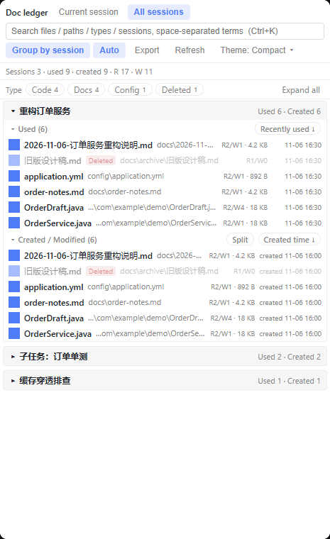

Fourteen commits since `v0.3.0`: **a fully bilingual UI**, correct English plurals, client sources split into fragments, and the test suite grown from 39 to 82 checks. **The engine (`lib/ledger.js`) and the host routes (`index.js`) are untouched**, so the data model and cache format are unchanged and upgrading needs no cleanup of `~/.dsh/doc-ledger-*`.


## Fully bilingual UI (zh / en)

- **Every string** in the panel now lives in the dictionary: 159 keys with matching Chinese and English, covering buttons, menus, empty states, toasts, the filter row, export, the preview dialog, and every `aria-label` and `title` (previously only 3 keys existed, so an English UI still showed Chinese text).
- Combination sentences are no longer glued from Chinese fragments; each is one full sentence with `{placeholders}`, so English word order is free.
- **Correct English plurals**: `Intl.PluralRules` picks the `_one` / `_other` dictionary variant, giving `1 file` / `2 files`; Chinese uses the same value for both forms, so its behaviour is unchanged.
- Evaluation-time tables (category names, sort-key labels) now store **keys** and resolve at render time — otherwise switching language would freeze the Chinese in place.
- Before `apply()` installs the host translator the dictionary falls back to Chinese, so a raw `a.b.c` key is never shown to the user.



## Client sources split into fragments

- `client.js` is split into **15 named fragments** under `src/client/`, and `tools/build-client.mjs` concatenates them in a fixed order with no bundler. The artifact is **byte-for-byte identical** before and after the split (same SHA256, no new dependencies).
- Why not real modules: the host loads a client plugin as **one `factory` closure** whose `require` injects `react` and nothing else, so relative imports are not guaranteed. The split is for readability and testability only.
- CI gained `npm run check:client`, which fails when the committed artifact drifts from the sources — no more "edited the source, forgot to rebuild".

## Tests grew from 39 to 82

- **+32 client pure-function assertions**: `node:vm` evaluates the **real source fragments** (not a copy of the logic), covering AND search, seven sort keys, cross-session merging, formatting, highlight range merging and `dsh-resource://` address construction.
- **+159 dictionary keys verified**: zh/en key sets match, no empty values or TODOs, every `t()` reference resolves, no dead entries, and placeholder sets agree.
- **+7 bilingual README checks**: both editions have the same section count and order, link to each other, the English one carries no Chinese, and all in-page anchors resolve.
- `npm test` is now **82 checks**, still with zero external dependencies.

## Documentation

- **A fully bilingual README**: `README.md` (English, the default) and `README.zh.md` (Chinese), cross-linked at the top.
- **One shared skeleton for "Traps we hit"** in both editions: host API contracts / runtime and platform / front-end rendering / caching, tests and other — each entry written as **symptom → cause → fix**. `windowsHide` and `ELECTRON_RUN_AS_NODE` still link to the detailed reproductions in the body.
- `docs/i18n.md` rewritten to describe what shipped; `docs/i18n-plan.md` kept as the design record; `tools/i18n-extract.mjs` can recompute any remaining hard-coded strings (only the command-palette search aliases are left).
- Added an English UI screenshot, `docs/en-overview.png`.

## Install / upgrade

```json
"dsh-doc-ledger": "github:LuoShanHui/dsh-doc-ledger#v0.4.0"
```

```powershell
node <runtime>/dependencies/pnpm/bin/pnpm.mjs install `
  --config.store-dir=<pnpm-store> `
  --config.confirmModulesPurge=false
```

Also on npm: `"dsh-doc-ledger": "0.4.0"`. Reload the page afterwards (the client bundle has to be re-injected).

## Compatibility

- DSH `>=0.2.0-rc.1 <0.3.0-0`; Node `>=18`; verified on **Windows** only.
- The UI language follows the host's `locale`; when the host has no `locale.getLocale()`, plurals fall back to the Chinese rule (one form for every count).
- Two host capabilities remain optional and degrade silently: `uiWorkspace.openSession` and `sidebarRight.openResource`.

## Known limitations

- Plurals use two forms (`_one` / `_other`) and do not cover languages needing `few` / `many` (Russian, Polish…). The dictionary structure already allows them; only the translations are missing.
- The documentation (this release note, the CHANGELOG, the design records under `docs/`) is still mostly Chinese; the README is the one fully bilingual document.
- Everything else is in the README's [Known limitations](https://github.com/LuoShanHui/dsh-doc-ledger#known-limitations).

## Tests

```bash
npm test          # 82 checks: engine 7 + decoder 10 + routes/security 14 + cache 8 + client 36 + i18n + README 7
npm run harness   # local UI verification page; add ?locale=en for the English UI
```

The full change history is in [CHANGELOG.md](https://github.com/LuoShanHui/dsh-doc-ledger/blob/main/CHANGELOG.md).
