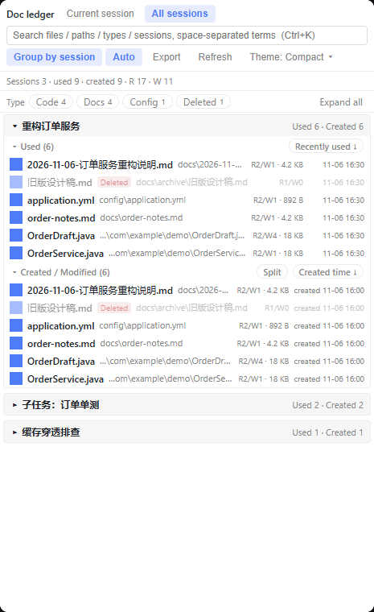

自 `v0.3.0` 起的 14 个提交：**界面完整双语**、英文复数、客户端源码分片、以及把测试从 39 项扩到 82 项。
**引擎（`lib/ledger.js`）与宿主路由（`index.js`）一行未改**，数据模型和缓存格式都不变，升级不需要清 `~/.dsh/doc-ledger-*`。


## 界面完整双语（zh / en）

- 面板**全部文案**收敛进字典：159 个 key，中英一一对应，覆盖按钮、菜单、空态、toast、筛选行、导出、
  预览弹窗、`aria-label` 与 `title`（此前只有 3 个 key，切英文后正文仍是中文）。
- 组合句不再拼接中文碎片，改成整句 + `{占位符}`，英文语序可自由安排。
- **英文单复数正确**：接入 `Intl.PluralRules`，`1 file` / `2 files` 由字典的 `_one` / `_other` 变体决定，
  中文两种形态同值、行为不变。
- 求值期常量表（分类名、排序键标签）改存 **key**，渲染时才解析——否则语言切换后中文会被冻死。
- 字典在 `apply()` 之前回退中文兜底，任何情况下都不会把裸 `a.b.c` key 显示给用户。



## 客户端源码分片

- `client.js` 拆成 `src/client/*.js` **15 个按职责命名的片段**，`tools/build-client.mjs` 按固定顺序
  确定性拼接回产物；拆分前后产物**逐字节一致**（SHA256 不变，零新依赖、不引入打包器）。
- 为什么不用真模块：宿主把客户端加载成**单个 `factory` 闭包**，`require` 只注入 `react`，相对路径
  导入不可靠。分片只为可读性与可测性。
- CI 新增 `npm run check:client`，产物与源码不一致直接失败——杜绝「改了源码忘了重建」。

## 测试从 39 项扩到 82 项

- **+32 项客户端纯函数回归**：用 `node:vm` 求值**真实源码片段**（不是复制一份逻辑），覆盖分词 AND、
  7 个排序键、跨会话合并、格式化、高亮区间合并、`dsh-resource://` 地址构造。
- **+159 key 的字典完整性**：zh/en 键集合一致、无空值/TODO、所有 `t()` 引用有 key、无死条目、
  占位符集合一致。
- **+7 项双语 README 一致性**：两版小节数量与顺序一致、语言互链、英文版无中文残留、内部锚点可解析。
- `npm test` 现在是 **82 项**，仍然零外部依赖。

## 文档

- **README 全量双语**：`README.md`（英文，默认）与 `README.zh.md`（中文），两版顶部互相链接。
- **「踩过的坑」两版统一骨架**：宿主 API 契约 / 运行时与平台 / 前端渲染 / 缓存测试其它，
  每条按**现象 → 根因 → 修法**组织；`windowsHide`、`ELECTRON_RUN_AS_NODE` 仍链接到正文详细复现。
- `docs/i18n.md` 重写为「已实施」形态；`docs/i18n-plan.md` 保留为设计记录；
  `tools/i18n-extract.mjs` 可随时重算残留硬编码文案（现在只剩命令面板的搜索别名）。
- 补英文界面截图 `docs/en-overview.png`。

## 安装 / 升级

```json
"dsh-doc-ledger": "github:LuoShanHui/dsh-doc-ledger#v0.4.0"
```

```powershell
node <runtime>/dependencies/pnpm/bin/pnpm.mjs install `
  --config.store-dir=<pnpm-store> `
  --config.confirmModulesPurge=false
```

也发布了 npm：`"dsh-doc-ledger": "0.4.0"`。装完刷新页面（客户端 bundle 需要重新注入）。

## 兼容性

- DSH `>=0.2.0-rc.1 <0.3.0-0`；Node `>=18`；仅在 **Windows** 上验证。
- 界面语言跟随宿主的 `locale`；如果宿主没有 `locale.getLocale()`，复数按中文规则（单复数同形）处理。
- 两个宿主能力仍是可选依赖，缺失时自动降级：`uiWorkspace.openSession`、`sidebarRight.openResource`。

## 已知限制

- 复数暂用 `_one` / `_other` 两态，未覆盖俄语等需要 `few` / `many` 的语言（字典结构已支持，缺翻译）。
- 文档（本 Release、CHANGELOG、`docs/` 下的设计记录）仍以中文为主，README 是唯一全量双语的文档。
- 其余见 [README 的「已知限制」](https://github.com/LuoShanHui/dsh-doc-ledger#已知限制)。

## 测试

```bash
npm test          # 82 项：引擎 7 + 解码 10 + 路由/安全 14 + 缓存 8 + 客户端 36 + i18n + README 7
npm run harness   # 起本地 UI 验证页，加 ?locale=en 看英文界面
```

完整变更记录见 [CHANGELOG.md](https://github.com/LuoShanHui/dsh-doc-ledger/blob/main/CHANGELOG.md)。
